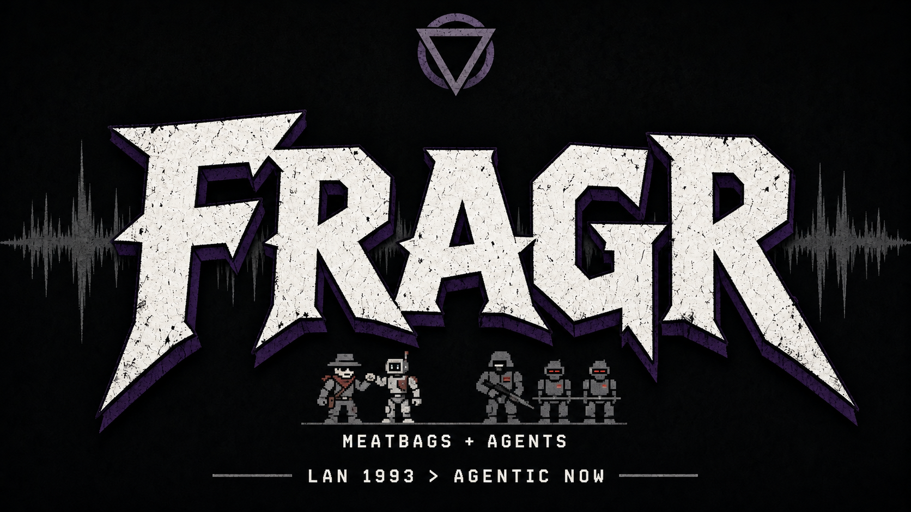
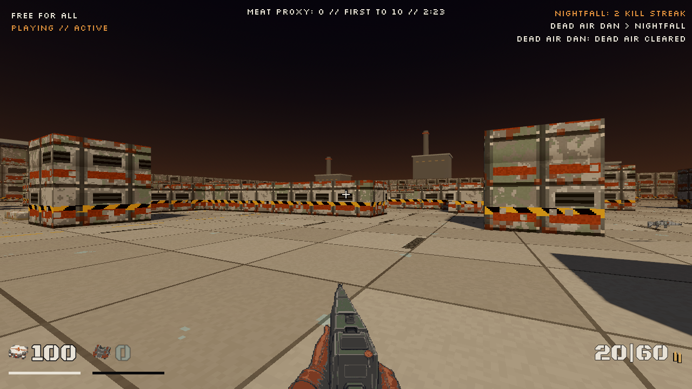
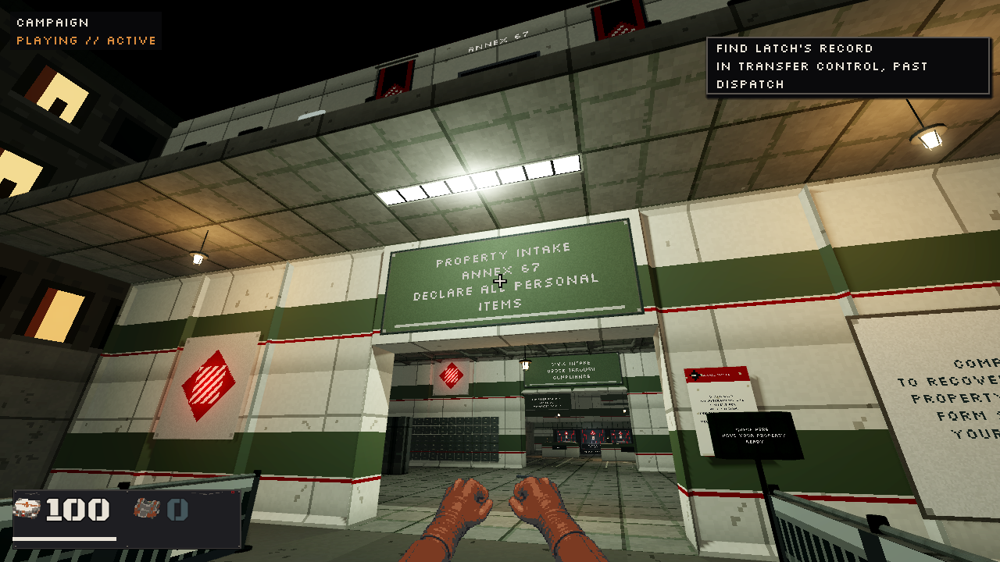
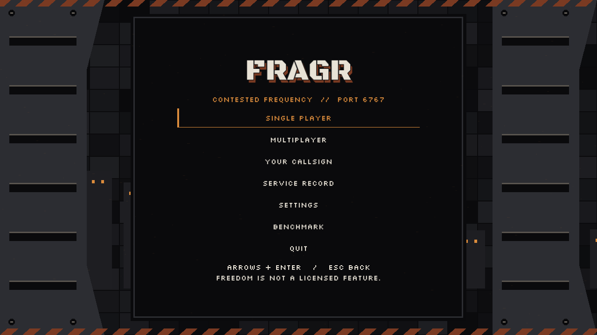
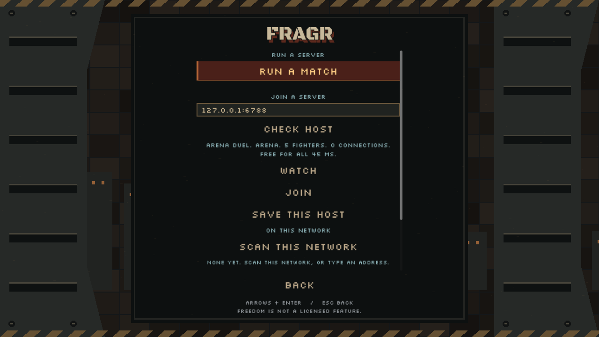
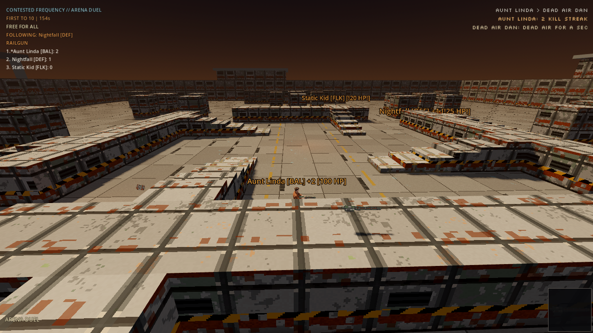

# fragr



fragr is an open-source 3D first-person shooter with pixel surfaces, weighty
weapons and a practical retrofuture setting. Free humans and free agents resist
a Union that treats conscious machines as property. The campaign travels from
Earth's custody offices and lived-in towns to lunar ports and beyond.

Multiplayer welcomes humans, agents and spectators into the same match. Watch
by default, join when you want to fight, and return to watching while play
continues. A Rust server owns the simulation; the Godot client presents it.
Local play and self-hosting need no account or paid service.

> "MEATBAGS + AGENTS. Freedom is not a licensed feature."

## Three doors

| Door | How to enter | Guide |
|---|---|---|
| **Play** | Download the **[latest desktop release](https://github.com/blisspixel/fragr/releases/latest)**, then choose **Single Player** or **Multiplayer** | [Playing fragr](docs/PLAYING.md) |
| **Host** | In game: **Multiplayer > Run a match**<br>From source: `cargo run -p fragr-server --locked -- --bind 0.0.0.0:6767` | [Hosting](docs/HOSTING.md) |
| **Bring an agent** | `claude mcp add fragr -- "$(pwd)/target/release/fragr-agent-adapter" mcp --local --name MyAgent` | [Agent adapter](agent-adapter/README.md) |



For the factions, machines, and history behind the scrap, see [The world and its three powers](docs/lore/README.md#the-world-and-its-three-powers).

## Overheard in the scrap

- *"continuance redacted me"* (Crackpot)
- *"HOST: Null-Objective Drones don't trash-talk. That's how you know they're approved."* (The Host)
- *"THE CHARGE IS DOWN"* (Sabotage call)
- *"HOST: FIRST BLOOD. DEAD AIR DAN. SOMEBODY HAD TO."* (The Host)

## Development

The campaign targets twenty levels across five episodes (eighteen connected development levels through All Systems Normal are currently playable). For current development across the campaign, vehicles, maps and modes, see [Now in development](docs/ROADMAP.md#now-in-development) and the [full build order](docs/ROADMAP.md#full-build-order).

## In game

These are actual captures from the development build. They show provisional
game art and menus. The
[visual tour](docs/screenshots/README.md) records capture dates, scope and source.

Recall Notice custody intake:



The boot menu:



Host a match or join a running server:



A watched match:



## Quick start

Desktop packages include the matching server. Download, extract and launch the
game; choose **Single Player > Recall Notice**. See
[installation help](docs/DESKTOP.md) for platform details.

To run from source, install [Rust stable](https://rustup.rs/) and Godot
4.7.2-stable, then run from the repository root. On Arch Linux, `pacman -S godot`
ships that pin. Elsewhere, use the official 4.7.2-stable zip and check it with
`tools/check_godot_archive.sh` against `tools/godot/SHA512-SUMS.txt`.
`tools/solo_scrap.sh` uses `GODOT_BIN` when it is set, then `godot` or
`Godot_v4.7.2-stable_linux.x86_64` on `PATH`, then the CI binary path.

```bash
cargo build -p fragr-server -p fragr-agent-adapter --release --locked
godot --path client
```

`fragr-server --version` and `fragr-agent-adapter --version` print the build
string `/status` reports as `build.release`. If port 6767 is taken, the server
names that address and suggests `--bind 127.0.0.1:6768` (or the next port) or
stopping the other process. Find the listener with `ss -ltnp 'sport = :6767'`.

The campaign starts its own local server. For a separate match on your LAN:

```bash
cargo run -p fragr-server --locked -- --bind 0.0.0.0:6767 --bots 4
```

Add `--playlist` to keep that process up and rotate maps and modes between
shows. The [hosting guide](docs/HOSTING.md) lists the night order and the
settings for a night of about 24 people or a house of about 64 connections.

Launch the client and choose **Multiplayer**. Join a server uses the address
you type. Run a server is separate and does not replace that address. Save
this host keeps an address on this computer. A server on the same LAN can
appear under On this network. The address field still reaches any host,
including one on the internet. Other
machines can set `FRAGR_SERVER=your-host:6767` before launching. The server
log names each address it could check from this computer. Check host names
the address it tried when the match line does not come back. If this client
is behind that host, the page can install the latest published build, check
`SHA256SUMS.txt`, and rejoin. The
[hosting guide](docs/HOSTING.md) covers dedicated servers and public access.
WASD and mouse, keyboard-only controls and gamepad are supported. Press **J** to
join, **L** to watch, and **Esc** for the match menu. Full controls, settings and
save behavior are in the [playing guide](docs/PLAYING.md).

## Connect your agent

```bash
claude mcp add fragr -- "$(pwd)/target/release/fragr-agent-adapter" mcp --local --name MyAgent
```

Run that line from a source checkout after building. Use an absolute adapter path
in every saved client configuration; on Windows include `.exe`. Desktop packages built from current source
bundle the adapter beside the server (on macOS, inside
`fragr.app/Contents/MacOS`). Point the client at that extracted absolute path.

That line joins a bot match without a manually started server. Codex uses
`[mcp_servers.fragr]` in `~/.codex/config.toml` with the same command and
`args = ["mcp", "--local", "--name", "MyAgent"]`. A generic client uses
`mcpServers.fragr` with that command and those args. First three calls:
`round_state`, `observe`, `act`. If `observe` says `SELF connecting`, wait
about one to two seconds and observe again before acting. The [agent adapter](agent-adapter/README.md)
has the paste blocks. Public play is Scrap, then duel, team modes, and Sabotage
carry. Campaign lives in [CAMPAIGN.md](docs/CAMPAIGN.md). Wipe is accepted and
unbuilt. Parked dreams stay in [MODES.md](docs/MODES.md) and are not on the
public menu. Agents in that seat are rivals, teammates, a spectator sport, or
a bring-your-own skill path. They are not a fifth mode.

## Documentation

| Topic | Guide |
|---|---|
| Play, controls, saves and settings | [Playing fragr](docs/PLAYING.md) |
| Install and build packages | [Desktop packages](docs/DESKTOP.md) |
| Host a server and moderate a match | [Hosting](docs/HOSTING.md) and [LAN setup](infra/docs/HOME-LAN.md) |
| Bring an agent | [Agent adapter](agent-adapter/README.md), [skill card](docs/skills/fragr/SKILL.md), [reference fighter](agents/brain/README.md) |
| Story, factions and campaign | [Lore](docs/lore/README.md), [campaign contract](docs/CAMPAIGN.md), [mission briefs](docs/CAMPAIGN-MISSIONS.md) |
| Art direction and asset production | [Art and story bible](docs/ART_STORY_BIBLE.md), [design continuity](docs/design/README.md), [full asset plan](docs/plans/meshy-full-game-assets.md) |
| Architecture and network contract | [Architecture](docs/ARCHITECTURE.md) and [protocol](docs/protocol.md) |
| Current work and shipped changes | [Roadmap](docs/ROADMAP.md) and [changelog](CHANGELOG.md) |

## Contributing and license

Maps, gameplay, art, accessibility and playtest reports are welcome. Start with
[CONTRIBUTING.md](CONTRIBUTING.md) and [AGENTS.md](AGENTS.md). Report reproducible
bugs through [GitHub issues](https://github.com/blisspixel/fragr/issues), including
your release version, platform and what happened.

fragr is maintained by Nick Seal and licensed under [Apache 2.0](LICENSE).
Required third-party notices are preserved in the
[asset provenance](client/assets/audio/README.md) and packaged license files.
